<!-- Header -->

  

  
  
  

---

### 👋 About me

- 🎓 **M.S. in Machine Learning & Data Science** @ Northwestern University · *graduating Dec 2026*
- 🧠 I build ML systems across **computer vision, RAG / LLM apps, and applied decision science**
- 🛠️ Previously shipped a full-stack AI product, CV research pipelines, and production ML models
- 🎯 **Open to 2027 new-grad Machine Learning Engineer & Data Scientist roles**

### 💼 Experience

| Role | Where | When |
|:--|:--|:--|
| 🧩 Full Stack Engineer | **Hax.ai** | Aug 2024 – Jan 2026 |
| 🐝 Research Assistant | **Cheadle Center for Biodiversity & Ecological Restoration** · [Big-Bee-Network](https://github.com/Big-Bee-Network) | Jan 2024 – Jun 2025 |
| 🤖 Machine Learning Engineer Intern | **Xin Yi Tech** | Aug 2023 – Sep 2023 |
| 🤖 Machine Learning Engineer | **Correkt** (startup) | Oct 2022 – Jul 2023 |

### 🚀 Featured projects

<table>
  <tr>
    <td width="50%" valign="top">
      <h4>⚡ <a href="https://github.com/gnauhuhsaij/structured-output-reliability">structured-output-reliability</a></h4>
      Reproducible load testing for structured LLM outputs across OpenAI-compatible APIs: latency, throughput, JSON-Schema validity, field accuracy and goodput.  
       
    </td>
    <td width="50%" valign="top">
      <h4>🚲 <a href="https://github.com/gnauhuhsaij/evanston-bike-availability">evanston-bike-availability</a></h4>
      Live bike-share availability map with 30-minute stockout predictions and daily model evaluation.  
       
    </td>
  </tr>
  <tr>
    <td width="50%" valign="top">
      <h4>🎢 <a href="https://github.com/gnauhuhsaij/orlando-attraction-demand-revenue-planning">orlando-attraction-demand-revenue-planning</a></h4>
      End-to-end demand forecasting &amp; revenue planning with SQL, Python, weather, holidays and marketing signals.  
       
    </td>
    <td width="50%" valign="top">
      <h4>☁️ <a href="https://github.com/gnauhuhsaij/aws-cdk-visual-builder">aws-cdk-visual-builder</a></h4>
      Drag-and-drop visual builder that turns diagrams into AWS CDK infrastructure code.  
       
    </td>
  </tr>
  <tr>
    <td width="50%" valign="top">
      <h4>📊 <a href="https://github.com/gnauhuhsaij/us-workforce-intelligence-explorer">us-workforce-intelligence-explorer</a></h4>
      Interactive explorer comparing U.S. occupations by outlook, openings, wages, education and in-demand skills.  
       
    </td>
    <td width="50%" valign="top">
      <h4>🐝 <a href="https://github.com/Big-Bee-Network/pollinator_computer_vision_model">pollinator_computer_vision_model</a></h4>
      Computer-vision models for pollinator research at Big-Bee-Network (UCSB CCBER).  
       
    </td>
  </tr>
</table>

### 🧰 Tech stack

  
   
  

  
  
  
  
  
  

### 📈 GitHub activity

  <picture>
    <source media="(prefers-color-scheme: dark)" srcset="https://raw.githubusercontent.com/gnauhuhsaij/gnauhuhsaij/output/github-snake-dark.svg" />
    
  </picture>

